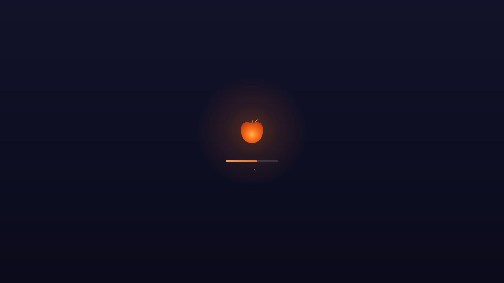
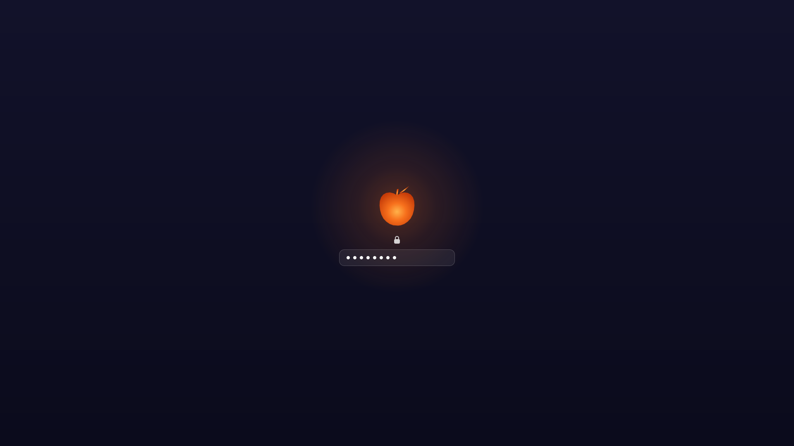

# Insane OS brand files

Insane OS is a Debian-based GNU/Linux distribution with a desktop built from scratch.

The brand identity (logo usage, colours, typography, the mascot) is described in
[`../INSANEOS-BRAND.md`](../INSANEOS-BRAND.md). This page is the file index.

The Insane OS logo is an orange apple — body, stem and leaf — with an amber heart and a soft gloss,
next to the wordmark **Insane OS**. Everything here is generated by `tools/gen-brand-insane.py` from
the vector sources in `assets/brand/`, so it stays in sync:

```sh
python3 tools/gen-brand-insane.py     # SVGs (assets/brand/), PNG renders (assets/icons/ and this
                                      # folder) and the Plymouth splash; standard library only
python3 tools/boot/gen-boot-assets.py # the boot splash + GRUB menu renders; needs rsvg-convert
```

The SVGs are real vectors (no embedded bitmaps). The apple is one mirrored half, so it is exactly
symmetric; the wordmark is outlined from the brand font at generation time (a TrueType parser in the
script — no fontTools). Its shapes have no strokes; the gloss is a radial highlight and the colour is
one amber → deep-orange radial gradient. Each file is under 6 KB.

| Light | Dark |
|---|---|
|  |  |
|  |  |
|  |  |

The menu bar glyph (light and dark menu bars, 3x) and the login screen wordmark (3x):


The screenshots come from a headless `insane-server` on VM 118, rendered offscreen at 1280 × 800.
The RTL one uses a test language pack: the English texts marked right to left.

## Files

### Vectors (`svg/`, copies of `assets/brand/`)

| File | What it is | Use it for |
|---|---|---|
| `svg/logo-horizontal-light.svg` | Apple and wordmark, navy text, transparent | Web headers and documents on light backgrounds; the README header (light) |
| `svg/logo-horizontal-dark.svg` | Apple and wordmark, white text, transparent | Web headers on dark backgrounds; the README header (dark, via `<picture>`) |
| `svg/logo-mono-black.svg` | One colour, black | Print, fax, engraving, light backgrounds where colour isn't possible |
| `svg/logo-mono-white.svg` | One colour, white | Photos and dark or busy backgrounds |
| `svg/app-icon.svg` | The apple on the warm dark rounded square (22 % radius) | App icon, store listings, avatars, 48 px and up |
| `svg/app-icon-small.svg` | The icon redrawn on a 32 px grid | 16 to 32 px: tabs, lists, the favicon |
| `svg/apple.svg` | The apple alone, transparent | A symbol next to other content, splash screens |
| `svg/apple-mono.svg` | The apple, one colour | Glyphs and stamps from 24 px up |
| `svg/apple-mono-small.svg` | The one-colour apple on a 16 px grid | Menu bars and toolbars at 12 to 20 px |
| `svg/social-card.svg` | 1200 × 630, the white lockup on the orange gradient | Link previews (Open Graph, social posts) |

### Renders (`png/`, `favicon/`)

| File | Use it for |
|---|---|
| `png/app-icon-{16,32,64,128,256,512,1024}.png` | App icon at fixed sizes (16 and 32 come from the small variant) |
| `png/logo-horizontal-{light,dark}-{400,800}.png` | Web headers at 1x (400 px wide) and 2x (800 px) |
| `png/logo-mono-{black,white}-800.png` | One-colour lockup |
| `png/apple-{256,512}.png` | The apple alone |
| `png/social-card-1200x630.png` | `og:image` / social card |
| `favicon/favicon.svg` | `<link rel="icon" type="image/svg+xml">` (the pixel-grid icon: sharp in a tab) |
| `favicon/favicon-32.png` | PNG favicon fallback |
| `favicon/apple-touch-icon-180.png` | Home screen icon on phones |
| `favicon/favicon-512.png` | Web app manifest |

```html
<link rel="icon" href="/favicon.svg" type="image/svg+xml">
<link rel="icon" href="/favicon-32.png" sizes="32x32">
<link rel="apple-touch-icon" href="/apple-touch-icon-180.png">
<meta property="og:image" content="/social-card-1200x630.png">
```

### Inside the OS (`assets/icons/`, `sdk/logo.js`)

| What | Where |
|---|---|
| `InsaneLogo` (the app icon; `insaneos-icon-*.png`, it picks the right size) | About, Settings → General, Monitor, Help, the Dock |
| `InsaneGlyph` (the one-colour apple, `insaneos-glyph-{light,dark}-{16,32}.png`) | The menu bar logo menu; it follows the menu text colour |
| `InsaneWordmark` (the apple as `insaneos-apple.png` plus live text in the brand face) | About and Settings → General (text only, under the icon); the login screen (with the apple) |
| `insaneos-apple.png` (256) / `insaneos-apple-512.png` | The apple for other consumers (`tools/demo`) |

## Colours

| Name | Hex | Where |
|---|---|---|
| Amber heart | `#FFB24A` | The apple's gradient core, top centre |
| Brand orange | `#F7701C` | The apple's gradient mid; the brand colour |
| Deep orange | `#C43A08` | The apple's gradient edge |
| Warm dark | `#180D09` | The app icon's rounded square |
| Splash glow | `#FF7A22` | The radial glow behind the apple at boot |
| Bar amber → orange | `#FF9A3C` → `#EB5C14` | The boot progress bar fill and its end cap |
| Navy ink | `#12122A` | The wordmark on light backgrounds |
| White ink | `#FFFFFF` | The wordmark on dark backgrounds |

## Typeface

The wordmark is set in **Plus Jakarta Sans** (SIL Open Font License 1.1, release 2.7.1 from
github.com/tokotype/PlusJakartaSans): "Insane OS" in **ExtraBold (800)**, with a normal word space.
The font file is in `assets/fonts/` (`PlusJakartaSans-ExtraBold.ttf`, license in
`PlusJakartaSans-LICENSE.txt`).

- **In the OS** it is live text: the engine loads the file as the `brand` font family
  (`fontFamily: 'brand'`, `server/src/ui/text.c`) the first time it's used, so it's sharp at any size
  and scale. Use `InsaneWordmark` instead of setting it by hand.
- **In the SVGs** the text is outlined from that same file by `tools/gen-brand-insane.py` (it parses
  the TrueType glyf outlines itself), so the SVGs look identical without the font installed.

Plus Jakarta Sans was chosen after comparing it with Inter (the UI font), Outfit, Manrope, Sora and
Urbanist against the original artwork. It matched the letter shapes (round `o` and `d`, short `r`,
open `S`) and the weight contrast best.

## Clear space and sizes

- **Clear space:** keep free space around the logo at least as large as **half the cap height** of
  the wordmark (around the icon: 10 % of its size). Nothing else (text, edges, other logos)
  goes inside it.
- **Proportions:** in the lockup the apple is about two and a half times the cap height, centred on
  the text, about half a cap height from it. Use the files as they are.
- **Minimum sizes:**
  - horizontal logo, 96 px wide (24 mm in print); below 120 px prefer the one-colour version;
  - app icon, 16 px (use `app-icon-small.svg` up to 32 px);
  - apple alone, 24 px (`apple-mono-small.svg` for 12 to 20 px glyphs);
  - live wordmark, 13 px font size.

## Don'ts

- Don't stretch, skew, rotate or re-proportion the logo, and don't move the apple to another side
  of the text (it stays on the left, also in right-to-left languages).
- Don't recolour the apple or swap its gradient for flat colour, and don't put the full-colour apple
  on a busy photo: use the one-colour version.
- Don't set the wordmark in another font or weight, remove the space ("InsaneOS"), or change the
  case ("INSANE OS", "Insaneos").
- Don't add effects: outlines, drop shadows, glows, bevels or textures (the app icon's own soft
  shadow is part of it).
- Don't place the light lockup on a dark background or the dark one on a light background.
- Don't use the detailed icon below 32 px or the detailed apple below 24 px; use the small variants.
- Don't redraw or trace the logo from screenshots. Edit `tools/gen-brand-insane.py` and regenerate.

## Boot splash and boot menu

What the screen shows from power-on to the login screen (`docs/ISO.md`, "Boot splash and boot menu";
`docs/RASPBERRY.md`, "Boot splash"). Calm and minimal: no text messages, nothing that moves except
the bar.

| Splash, mid-boot (static preview, 1x) | Splash, encrypted disk |
|---|---|
|  |  |

| Part | Spec (1x, for 1080p; @2x files for 4K) |
|---|---|
| Background | vertical gradient `#12122A` (top) → `#0B0B1C` (bottom) |
| Apple | `apple.svg` at 112 px, centred, 40 px above the middle |
| Glow | a 420 px radial gradient of `#FF7A22` behind the apple, 30 % → 12 % → 0 alpha. It is light *behind* the logo on the background, not an effect on the logo (see "Don'ts") |
| Progress bar | 200 × 6 px, 56 px under the apple; track white at 12 %; fill `#FF9A3C` → `#EB5C14` with round caps; eased, never goes back |
| Wordmark | the lockup's outlined Plus Jakarta Sans text, 12 px high, white at 55 %, 28 px under the bar |
| Password field | 280 × 40 px, 12 px radius, white at 7 % with a 22 % hairline; white dots and a small lock above |
| Boot menu (GRUB) | the same background with a soft glow, the apple at 96 px, entries in Inter 16 (`#B9B6D9`, selected white on a rounded orange band `#F7701C` at 34 % with an `#FF9A3C` hairline); no countdown bar (GRUB draws it a text line high) |

The files are generated, never edited by hand: `python3 tools/boot/gen-boot-assets.py` renders
`tools/boot/plymouth/insaneos/*.png` (1x and @2x) and `tools/iso/grub/insaneos/*.png` from
`assets/brand/apple.svg` and `logo-horizontal-dark.svg` with rsvg-convert; `--preview` writes the
previews above. The script lays the theme out at run time (`insaneos.script`).

## Lumo, the mascot (`mascot/`)

Lumo, the guardian of Insane OS: a small celestial fox with white fur and violet highlights, who wears
the Insane OS apple and a violet cape as symbols of protection, freedom and control. Big pointed fox
ears; abundant fluffy white fur, like an arctic fox; a short, fluffy, slightly curved tail; a round,
kitten-like face with big expressive eyes; a small, compact fantasy-creature body. The story, the
pose table, the palette and the do's and don'ts are in [INSANEOS-BRAND.md](../INSANEOS-BRAND.md#6-lumo-the-guardian-of-insaneos).

- `mascot/*.svg`: copies of `assets/brand/mascot/` (views: front, three-quarter, back; poses: wave,
  shield, run, sleep, celebrate, confused; `lumo-avatar` and `lumo-avatar-small` for 24–32 px).
- `mascot/png/`: 512 and 1024 px renders of the views and poses; 64/128/256 of the avatar and
  24/32/64 of the small avatar.
- `mascot/screens/`: Lumo inside Insane OS.

They are generated by `python3 tools/gen-mascot.py` from the parts in
`assets/brand/mascot/src/lumo-parts.svg` (`--parts` rewrites that file from the script). The UI
draws the renders in `assets/mascot/` through `sdk/mascot.js`.
